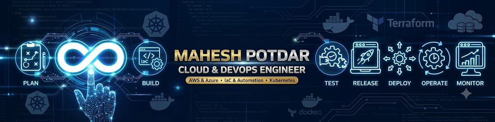
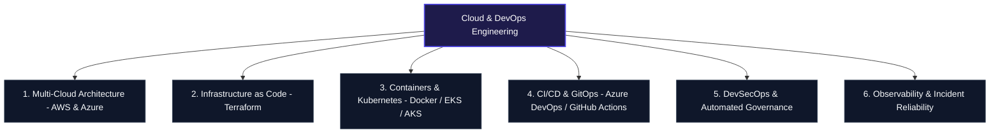

<div align="center">

# ☁️ MAHESH POTDAR (`Maahesh24`)
### **Engineering the Autonomous Enterprise: Cloud Sovereignty, DevSecOps & Enterprise AI**
*Cloud & DevOps Engineer • Multi-Cloud Architecture (AWS & Azure) • Infrastructure as Code • Kubernetes*

---

` 🛡️ ISO 27001 ALIGNED ` ` 🔒 ZERO-TRUST DEVSECOPS ` ` 🔄 GITOPS DRIVEN ` ` ⚡ 99.99% HIGH AVAILABILITY ` ` 💰 FINOPS OPTIMIZED `

---

### **MAHESH POTDAR ENTERPRISE NETWORK**
| 🌐 [ENTERPRISE PORTAL](/Maahesh24) | 🚀 [PRODUCTION PLATFORM](/Maahesh24/Azure-devops-production-platform) | 🏗️ [TERRAFORM IAC](/Maahesh24/terraform-ec2-project-) | ☁️ [CLOUD SETUP][...] |
| :---: | :---: | :---: | :---: | :---: |

</div>

---

## 📑 Strategic Portfolio & Repository Navigation

| Flagship Project / Platform | Domain & Architectural Focus | Repository Link |
| :--- | :--- | :--- |
| **Azure DevOps Production Platform** | Enterprise CI/CD, Multi-Stage Pipelines & Governance | [Azure-devops-production-platform](/Maahesh24/Azure-devops-production-platform) |
| **AWS Terraform EC2 Automation** | Declarative IaC, Modular VPC & Compute Provisioning | [terraform-ec2-project-](/Maahesh24/terraform-ec2-project-) |
| **Multi-Cloud Terraform Setup** | Cross-Cloud Landing Zones & State Management (AWS/Azure) | [terraform-cloud-setup](/Maahesh24/terraform-cloud-setup) |
| **Terraform Zero to Hero** | 7-Day Comprehensive HCL & Infrastructure Mastery | [terraform-zero-to-hero](/Maahesh24/terraform-zero-to-hero) |
| **DevOps Engineering Hub** | End-to-End Automation Scripts, Containers & Tooling | [Devops](/Maahesh24/Devops) |

---

## 🏛️ Engineering Operating Model

I design and automate resilient, production-grade cloud platforms across **AWS** and **Microsoft Azure**. My focus is on transforming manual infrastructure and fragmented deployments into self-healing, policy-driven, highly observable systems that accelerate product delivery while preserving security and cost control.

```text
┌──────────────────────────────────────────────────────────────────────────────┐
│                CLOUD & DEVOPS ENGINEERING OPERATING MODEL               │
└────────────────────────────────────┬───────────────────────────┬────────────┘
                                     │                           │
          ┌───────────────────────────┼───────────────────────────┐
          ▼                           ▼                           ▼
┌─────────────────┐         ┌─────────────────┐         ┌─────────────────┐
│  MULTI-CLOUD &  │         │   DECLARATIVE   │         │   ZERO-TRUST    │
│  FINOPS INFRA   │         │   IAC & GITOPS  │         │   DEVSECOPS     │
│  (AWS & Azure)  │         │   (Terraform)   │         │   PIPELINES     │
└────────┬────────┘         └────────┬────────┘         └────────┬────────┘
          │                           │                           │
          └───────────────────────────┼───────────────────────────┘
                                      │
                                      ▼
             ┌─────────────────────────────────────────────────┐
             │        PRODUCTION PLATFORM CAPABILITIES         │
             │  • Container Orchestration (Docker, EKS, AKS)   │
             │  • Automated CI/CD (Azure DevOps, GitHub Actions)│
             │  • Full-Stack Telemetry (Prometheus & Grafana)  │
             └─────────────────────────────────────────────────┘
```

---

## 📈 Engineering Impact & Benchmarks

| Strategic Metric | Target Benchmark | Architectural Lever |
| :--- | :--- | :--- |
| **Provisioning Velocity** | **90%+ Faster Delivery** | Reusable Terraform modules, remote state locking, automated PR plans |
| **Release Lead Time** | **Hours → Minutes** | Multi-stage Azure DevOps & GitHub Actions pipelines with automated gates |
| **Infrastructure Reliability** | **99.99% Uptime SLA** | Multi-AZ cloud topologies, auto-scaling groups, Kubernetes self-healing |
| **Security & Compliance** | **Zero-Trust Posture** | Automated secret scanning, container image hardening, least-privilege IAM |
| **Cloud Cost Efficiency** | **25–35% Run-Rate Savings** | Right-sizing compute, spot/reserved instances, automated cleanup schedules |

---

## 🌐 Core Practice Areas & Architecture



### 1. Multi-Cloud Strategy & Sovereign Infrastructure (AWS & Azure)
* **Production Landing Zones:** Architecting secure, multi-tier VPC/VNet topologies, transit gateways, load balancers, and high-availability compute across AWS and Azure.
* **FinOps & Resource Optimization:** Continuous right-sizing, automated tagging enforcement, and cost-anomaly tracking.

### 2. Declarative Infrastructure as Code (Terraform)
* **Modular HCL Architecture:** Building DRY, reusable Terraform modules for compute, networking, IAM, and managed databases.
* **State & Drift Governance:** Remote state management with locking, workspace isolation across Dev/Stage/Prod, and automated drift detection.

### 3. Container Orchestration & Cloud-Native Platforms
* **Kubernetes Lifecycle (EKS & AKS):** Deploying and managing production clusters with automated horizontal pod autoscaling (HPA), ingress controllers, and Helm charts.
* **Microservices Containerization:** Multi-stage Docker builds optimized for minimal attack surface and rapid startup times.

### 4. Continuous Delivery & DevSecOps Automation
* **Enterprise Pipelines:** End-to-end build, test, security scan, and deployment orchestration using **Azure DevOps**, **GitHub Actions**, and **Jenkins**.
* **Shift-Left Security:** Integrating static code analysis, container vulnerability scanning, and policy-as-code directly into pull request workflows.

---

## 🛠️ Complete Technology Radar

| Category | Tools & Technologies |
| :--- | :--- |
| **Cloud Providers** | Amazon Web Services (EC2, S3, VPC, IAM, EKS, RDS, CloudWatch), Microsoft Azure (VMs, AKS, VNet, Azure DevOps) |
| **Infrastructure as Code** | Terraform, HCL, CloudFormation, ARM Templates |
| **CI/CD & GitOps** | Azure DevOps Pipelines, GitHub Actions, Jenkins, ArgoCD, Git |
| **Containers & Orchestration** | Docker, Kubernetes (EKS, AKS), Helm, Container Registries (ECR, ACR) |
| **OS, Scripting & Networking** | Linux (Ubuntu, RHEL, CentOS), Bash Scripting, Python, DNS, TCP/IP, Nginx |
| **Monitoring & Security** | Prometheus, Grafana, ELK Stack, Azure Monitor, IAM Policy Design, Trivy |
