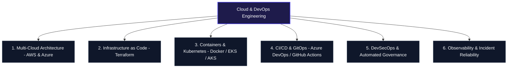

# 🦁 MAHESH POTDAR 🦁
### **TRANSFORMING INFRASTRUCTURE • SECURING AUTONOMOUS PLATFORMS**
*Elite Cloud & DevOps Portfolio • Multicloud Architecture • Automated Governance*

---

` 🛡️ ISO 27001 ALIGNED ` ` 🔒 ZERO-TRUST DEVSECOPS ` ` 🔄 GITOPS DRIVEN ` ` ⚡ 99.99% HIGH AVAILABILITY ` ` 💰 FINOPS OPTIMIZED `

---

### **MAHESH POTDAR ENTERPRISE NETWORK**
| 🌐 [ENTERPRISE PORTAL](https://github.com/Maahesh24) | 🤝 [LINKEDIN](https://linkedin.com) | 🛠️ [DEVOPS HUB](https://github.com/Maahesh24/Devops) |
| :---: | :---: | :---: |

### Engineering the Autonomous Enterprise: Cloud Sovereignty, DevSecOps & Enterprise AI
*Global Digital Transformation Partner across Multi-Cloud Environments • Operating in Scale-Ready Infrastructures*

## 📑 Strategic Portfolio & Repository Navigation

| Repository | Focus Area & Description | Key Technologies | Status |
| :--- | :--- | :--- | :--- |
| [**Devops**](https://github.com/Maahesh24/Devops) | Complete DevOps pipeline implementations, infrastructure as code, and cloud architecture | Terraform, Docker, Kubernetes, CI/CD | Active |
| [**Maahesh24**](https://github.com/Maahesh24/Maahesh24) | Central profile repository, enterprise portfolio showcase, and professional summary | Markdown, GitHub Actions | Active |

---

## 🛠️ Core Practice Areas & Architecture

### 1. Multi-Cloud Strategy & Sovereign Infrastructure (AWS & Azure)
* **Production Landing Zones:** Architecting secure, multi-tier VPC/VNet topologies, transit gateways, load balancers, and high-availability compute across AWS and Azure.
* **FinOps & Resource Optimization:** Continuous right-sizing, automated tagging enforcement, and cost-anomaly tracking.

### 2. Declarative Infrastructure as Code (Terraform)
* **Modular HCL Architecture:** Building DRY, reusable Terraform modules for compute, networking, IAM, and managed databases.
* **State & Drift Governance:** Remote state management with locking, workspace isolation across Dev/Stage/Prod, and automated drift detection.

### 3. Container Orchestration & Cloud-Native Platforms
* **Kubernetes Lifecycle (EKS & AKS):** Deploying and managing production clusters with automated horizontal pod autoscaling (HPA), ingress controllers, and Helm charts.
* **Microservices Containerization:** Multi-stage Docker builds optimized for minimal attack surface and rapid startup times.

### 4. Continuous Delivery & DevSecOps Automation
* **Enterprise Pipelines:** End-to-end build, test, security scan, and deployment orchestration using **Azure DevOps**, **GitHub Actions**, and **Jenkins**.
* **Shift-Left Security:** Integrating static code analysis, container vulnerability scanning, and policy-as-code directly into pull request workflows.

---

## 🛠️ Complete Technology Radar

| Category | Tools & Technologies |
| :--- | :--- |
| **Cloud Providers** | Amazon Web Services (EC2, S3, VPC, IAM, EKS, RDS, CloudWatch), Microsoft Azure (VMs, AKS, VNet, Azure DevOps) |
| **Infrastructure as Code** | Terraform, HCL, CloudFormation, ARM Templates |
| **CI/CD & GitOps** | Azure DevOps Pipelines, GitHub Actions, Jenkins, ArgoCD, Git |
| **Containers & Orchestration** | Docker, Kubernetes (EKS, AKS), Helm, Container Registries (ECR, ACR) |
| **OS, Scripting & Networking** | Linux (Ubuntu, RHEL, CentOS), Bash Scripting, Python, DNS, TCP/IP, Nginx |
| **Monitoring & Security** | Prometheus, Grafana, ELK Stack, Azure Monitor, IAM Policy Design, Trivy |
| **CI/CD & Automation** | GitHub Actions, Jenkins |

---

### 📌 What I Do

- 🏗️ **Infrastructure Automation**: Provisioning cloud resources using Terraform.
- 🐳 **Containerization & Orchestration**: Deploying microservices with Docker and Kubernetes.
- 🔄 **CI/CD Pipelines**: Automating testing, build, and deployment workflows.
- 🛡️ **Cloud Security & Operations**: Implementing best practices for AWS and Azure environments.
